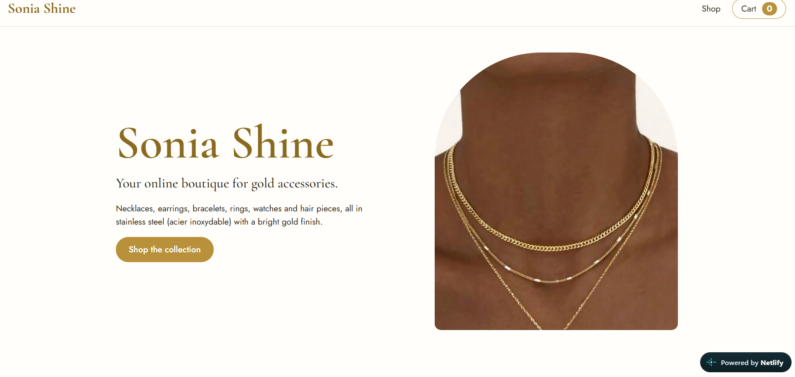
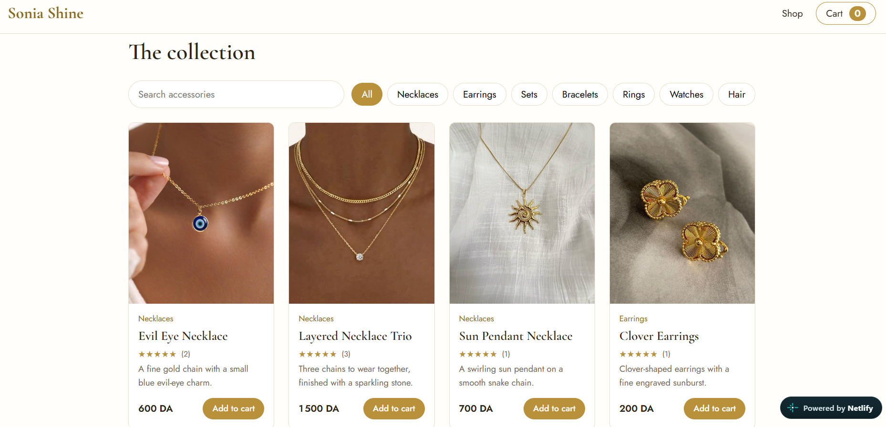
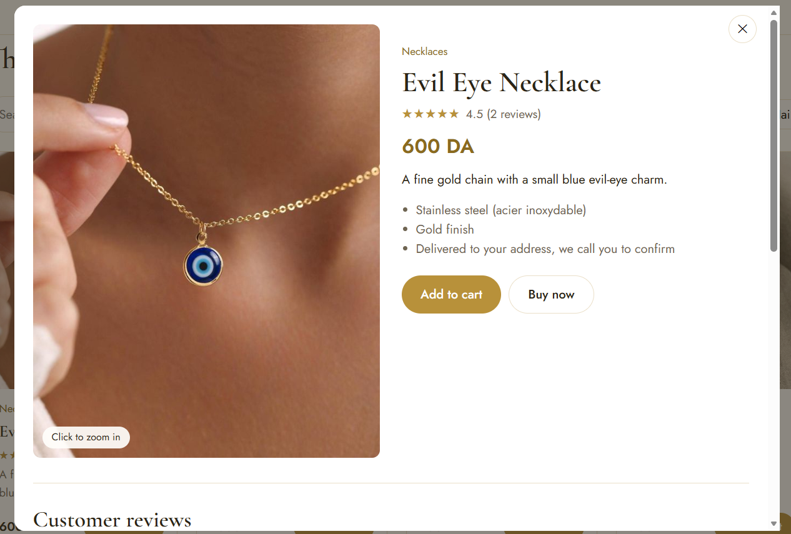
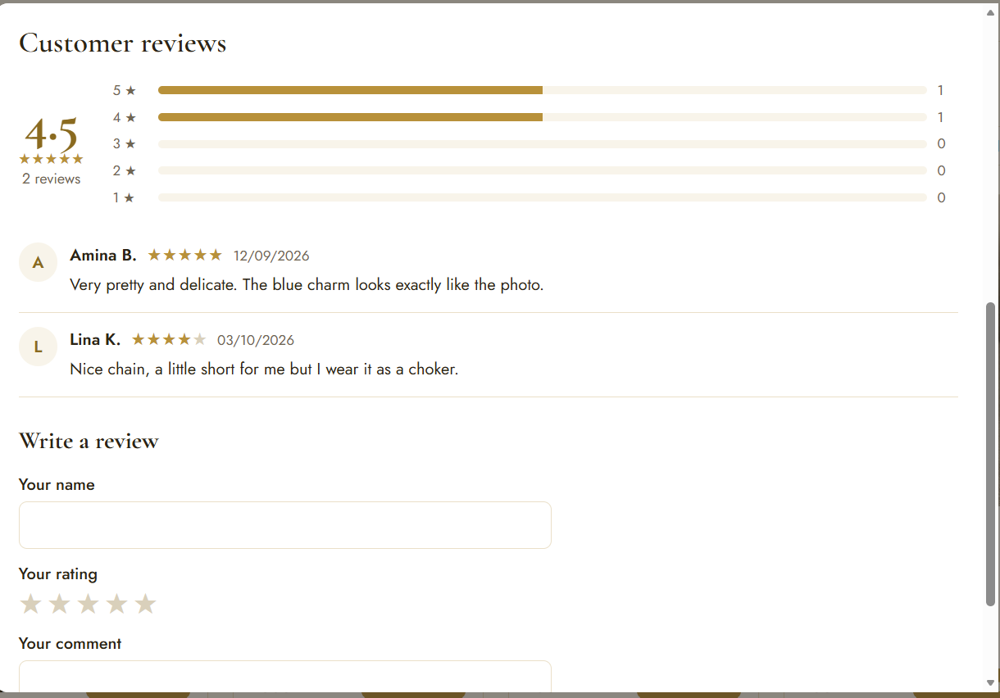
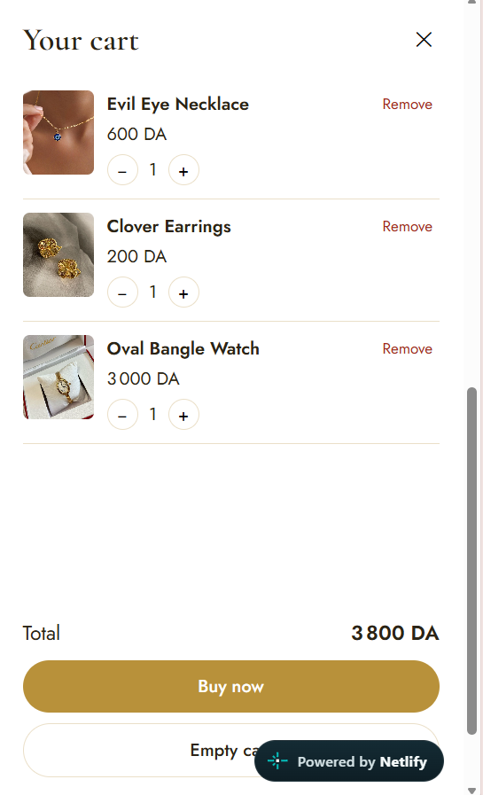
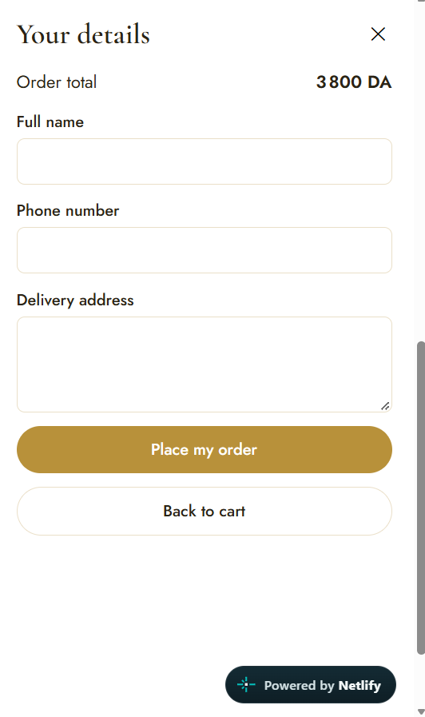
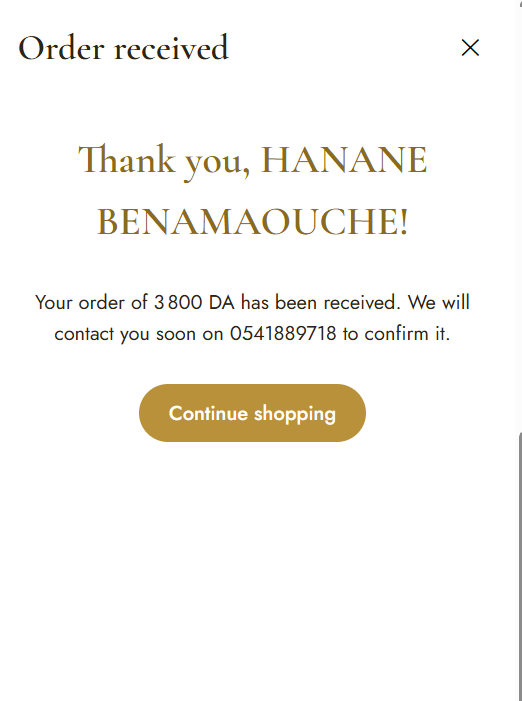

# Sonia Shine

**Student:** Benamaouche Sonia
**Module:** WAMD, TD-TP 2, ENSTA SS1

**Live demo:** https://soniashine.netlify.app
**GitHub repository:** https://github.com/soniabena2005/Sonia_Shine

---

## About the application

Sonia Shine is an online boutique for gold-colored accessories made of stainless steel (acier inoxydable). The shop sells necklaces, earrings, bracelets, rings, watches, matching sets and headbands, with prices in Algerian dinars (DA).

A visitor can browse the collection, search and filter it, open any product to see it up close, read and write customer reviews, add items to a cart, and place an order by giving a name, a phone number and a delivery address. After the order, a thank-you message tells the customer that the shop will contact them soon.

This project is a React front end for the TD-TP 2 lab. It has no backend or database, so orders and reviews only live in the browser while the page is open.

## Screenshots

| Home | Collection |
|---|---|
|  |  |

| Product details | Customer reviews |
|---|---|
|  |  |

| Cart | Order form |
|---|---|
|  |  |

| Thank-you message |
|---|
|  |

## Technologies

- React 18 with JSX
- JavaScript (ES6+)
- Redux Toolkit and React-Redux
- Vite
- Node.js and npm
- Netlify for the online version

## Features

**Required by the lab**
- Product catalog with photo, name, category, description and price
- Add to cart, remove from cart, and a cart that updates right away
- Global state handled with a Redux store, actions and reducers
- Components read the state with `useSelector` and change it with `useDispatch`

**Extra features**
- Search by product name and filter by category
- Product detail window with a large photo and click-to-zoom
- Customer reviews: average rating, a bar for each star level, the list of reviews, and a form to post a new one
- Quantity buttons in the cart and a running total
- "Buy now" order form with validation (the phone number must be a valid Algerian mobile number)
- Thank-you message after an order
- Responsive layout that works on phones

## Main React components

| Component | What it does |
|---|---|
| `App` | Puts the page together |
| `Header` | Shop name, link to the collection, cart button with the number of items |
| `Hero` | Welcome section |
| `ProductList` | Search box, category buttons and the product grid |
| `ProductCard` | One product in the grid. It receives the product as a prop |
| `ProductModal` | Detail window for one product, with zoom |
| `ReviewSection` | Rating summary, review list and the review form |
| `Stars` | Shows a rating in stars, and the clickable stars used in the form |
| `Cart` | Side panel with three steps: cart, customer details, thank-you |
| `CartItem` | One line in the cart with quantity buttons and a remove button |
| `CheckoutForm` | Order form with name, phone and address |

## Redux state

```js
{
  cart: {
    items: [{ id, name, price, image, quantity }],
    isOpen: false,
    step: "cart",          // "cart" | "checkout" | "done"
    orders: [],
    lastOrder: null
  },
  product: {
    selectedId: null       // the product currently shown in the detail window
  },
  reviews: {
    byProduct: { 1: [{ id, name, rating, comment, date }] }
  }
}
```

The three slices are in `src/store`:

| File | Actions |
|---|---|
| `cartSlice.js` | `addToCart`, `removeFromCart`, `increaseQuantity`, `decreaseQuantity`, `clearCart`, `openCart`, `closeCart`, `goToCheckout`, `backToCart`, `placeOrder` |
| `productSlice.js` | `openProduct`, `closeProduct` |
| `reviewsSlice.js` | `addReview` |

`store.js` combines them, and `main.jsx` gives the store to the whole app with `<Provider>`.

Some things stay in local React state (`useState`) because only one component needs them: the search text and chosen category, the zoom on the product photo, the "Added" feedback on buttons, and the fields of the order and review forms.

## Project structure

```
sonia-shine/
├── public/products/      product photos
├── src/
│   ├── components/       React components
│   ├── data/products.js  the product list
│   ├── store/            Redux store and slices
│   ├── App.jsx
│   ├── main.jsx
│   └── index.css
├── index.html
├── package.json
└── vite.config.js
```

## Run it on your computer

You need Node.js (version 18 or later) installed.

```bash
git clone https://github.com/soniabena2005/Sonia_Shine.git
cd Sonia_Shine
npm install
npm run dev
```

Then open the address shown in the terminal, usually http://localhost:5173.

To make the production version, run `npm run build`. The result is in the `dist` folder.

## Notes and limits

- There is no backend, so nothing is saved after the page is refreshed. Orders and new reviews only exist in the Redux store during the visit.
- The reviews that appear at the start are sample data written for the demo. They are not from real customers.
- Payment and user accounts are not part of this lab.